<a href="https://x.com/gmaronok">x</a> &nbsp;·&nbsp; <a href="https://www.linkedin.com/in/gastonmaron/">linkedin</a> &nbsp;·&nbsp; <a href="https://medium.com/@gastonmaron">medium</a> &nbsp;·&nbsp; <a href="https://github.com/tpii">tpii</a> &nbsp;·&nbsp; <a href="https://cafecito.app/gmaron">cafecito</a>

**Ahora:** Software Technical Leader de Agents IA · construyendo Paso 1, un radar de vacantes.
**Escribo** en [Medium](https://medium.com/@gastonmaron) y [X](https://x.com/gmaronok) sobre fundamentals, entrevistas técnicas y system design.
**Enseño** Ingeniería de Software con Coding Agents (EducaciónIT) y Taller de Proyecto 2 (UNLP, +10 años).

